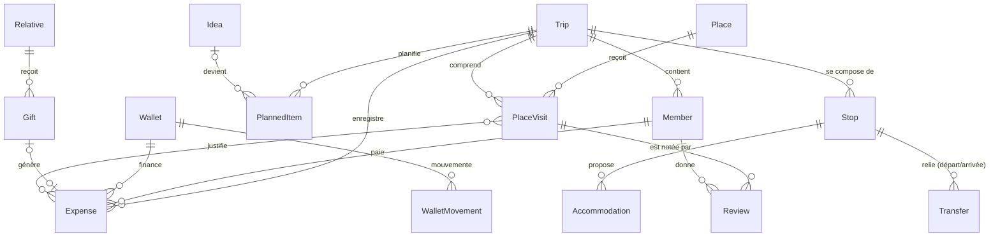

# Cahier des charges — Về Quê

| | |
|---|---|
| **Projet** | Về Quê (`ve-que`) — application de préparation et d'accompagnement de voyage au Vietnam |
| **Version du document** | 1.1 (ajout du module M17 « Carnet d'adresses ») |
| **Date** | 23/11/2026 |
| **Statut** | Phase 0 livrée ; M17 ajouté le 23/11/2026 |
| **Porteur** | Utilisateur principal (étudiant en développement logiciel) |

> *Về quê* : « rentrer au pays natal », retourner au village de la famille.

---

## 1. Présentation du projet

### 1.1 Contexte
- Voyage en famille (**4 personnes**) au Vietnam, **3 semaines**, été 2027. Billets d'avion pas encore réservés (durée sûre à ~90 %).
- Étapes prévues : **Hô Chi Minh-Ville, Phu Quoc, Da Nang, Hoi An, Hue**, plus des **petits villages** pour rendre visite à la famille.
- Appareils : **PC** pour planifier, **téléphone Android** sur place.
- Réseau sur place parfois absent (villages, trajets, île) : l'application doit être **pleinement utilisable hors ligne**.

### 1.2 Problèmes à résoudre (par ordre d'importance)
1. **Se perdre dans les dépenses** : ne plus savoir combien on a dépensé, dans quoi, et combien il reste en liquide.
2. **Ne pas savoir quoi faire sur place.**
3. **Ne pas avoir de plan défini**, tout en gardant des moments libres pour se balader.

### 1.3 Objectifs
| # | Objectif | Indicateur de réussite |
|---|---|---|
| O1 | Savoir à tout moment où en est l'argent | Toute dépense saisie en **moins de 5 secondes** ; solde espèces exact à ±5 % après recomptage |
| O2 | Toujours avoir une idée d'activité adaptée | Une suggestion pertinente en **moins de 3 interactions** depuis l'écran d'accueil |
| O3 | Avoir un plan clair mais souple | Chaque jour du voyage planifié par créneaux avant le départ |
| O4 | Fonctionner partout | 100 % des fonctions de consultation et de saisie disponibles hors ligne |

### 1.4 Utilisateurs
| Profil | Rôle | Usage |
|---|---|---|
| **Moi** (utilisateur principal) | Administrateur du voyage | Planifie sur PC, saisit les dépenses et consulte le planning sur Android |
| **Famille** (3 autres voyageurs) | Membres du voyage | v1 : n'utilisent pas l'appli, mais apparaissent comme **membres** (payeurs, participants). v2 (backend) : comptes permettant de **consulter et modifier** le voyage |

### 1.5 Contraintes
- **Temps** : 4 à 6 h par semaine, soit ~150 h jusqu'au départ.
- **Échéance dure** : l'itinéraire doit être utilisable **dès mars 2027** pour planifier ; tout doit être stable **avant fin juin 2027**.
- **Coût** : services gratuits uniquement (hébergement, API).
- **Langue** : interface en français ; textes centralisés pour permettre une traduction ultérieure.

---

## 2. Glossaire

| Terme | Définition |
|---|---|
| **Voyage** | Ensemble d'un séjour : dates, membres, étapes, budget. L'appli gère **plusieurs voyages**. |
| **Membre** | Personne participant au voyage (moi + famille). |
| **Étape** | Lieu de séjour sur une période (ville ou village), avec un ou plusieurs hébergements. |
| **Trajet** | Déplacement entre deux étapes (avion, bus, train, voiture, bateau…). |
| **Jour** | Date du voyage, rattachée à l'étape où l'on se trouve. |
| **Créneau** | Partie d'un jour : **matin**, **après-midi** ou **soir**. Peut porter une heure précise optionnelle. |
| **Idée** | Activité possible dans une ville (banque d'idées), pas encore planifiée. |
| **Élément planifié** | Activité placée dans un créneau (issue d'une idée ou saisie librement), ou bloc **temps libre**. |
| **Dépense** | Sortie d'argent : montant, devise, catégorie, payeur, portefeuille. |
| **Portefeuille** | Source d'argent : espèces (par devise) ou carte bancaire. |
| **Mouvement** | Opération sur un portefeuille qui n'est pas une dépense : retrait au distributeur, change, ajustement. |
| **Devise de référence** | Devise dans laquelle sont calculés budget et statistiques (EUR). |
| **Lieu** | Établissement fréquenté (hôtel, restaurant, magasin), conservé dans le **carnet d'adresses**, commun à tous les voyages. |
| **Visite** | Passage dans un lieu à une date donnée, au cours d'un voyage. Un lieu peut avoir plusieurs visites. |
| **Avis** | Note de 1 à 5 étoiles et commentaire d'un membre sur une visite. |

---

## 3. Périmètre

### 3.1 Priorisation
Chaque exigence porte une priorité **MoSCoW** :
- **M** (*Must*) : indispensable, l'appli n'a pas de sens sans.
- **S** (*Should*) : important, prévu dans le planning.
- **C** (*Could*) : souhaité, sacrifié en premier en cas de retard.

### 3.2 Modules retenus
| Module | Contenu | Phase |
|---|---|---|
| M1 | Voyages et membres | 1 |
| M2 | Itinéraire (étapes, trajets, jours, créneaux) | 1 |
| M3 | Banque d'idées + « J'ai du temps libre » | 1 / 3 |
| M4 | Carte intégrée (en ligne) | 1 |
| M5 | Dépenses (saisie rapide « 50k », répartition) | 2 |
| M6 | Portefeuilles (espèces, carte) | 2 |
| M7 | Budget (descendant / ascendant) | 2 |
| M8 | Écran « Aujourd'hui » | 3 |
| M9 | Checklist avant départ | 3 |
| M10 | Météo par étape | 3 |
| M11 | Famille : fiches + liste de cadeaux | 3 |
| M12 | Journal de voyage | 4 |
| M13 | Aide billets VND | 4 |
| M14 | Prix de référence (déduits du carnet d'adresses) | 4 |
| M15 | Données : export/import, sauvegarde | 1 / 4 |
| M16 | Paramètres | transverse |
| M17 | Carnet d'adresses : lieux visités, visites, avis 5 étoiles | 2 / 4 |

### 3.3 Hors périmètre (v1)
| Élément | Raison / devenir |
|---|---|
| Gestion de réservations dédiée + billets PDF hors ligne | Non retenu. Les éléments planifiés, hébergements et trajets gardent un statut « réservé » et une référence de réservation. **À reconfirmer.** |
| Mode chauffeur (adresse plein écran) | Non retenu. Le champ « adresse en vietnamien » existe tout de même sur les lieux. |
| Calendrier lunaire | Non retenu. |
| Photo du reçu sur une dépense | Non retenu. |
| Mode sombre | Plus tard. Les couleurs sont définies en variables dès le départ pour le permettre. |
| Carte hors ligne | Trop coûteux (25 h+). Hors ligne, la carte est remplacée par une liste. |
| Notifications / rappels | Plus tard. |
| Backend et synchronisation automatique | v2, après le MVP (voir §6.5). |
| Partage du carnet d'adresses (export, lien) | Plus tard. Le modèle de données le permet sans changement. |
| Autres types de lieux (cafés, stands, marchés, sites) | Plus tard, selon l'usage. Le type de lieu est une liste extensible. |
| Avis saisis par la famille depuis leurs propres comptes | v2 (comptes). En v1, l'utilisateur peut saisir l'avis d'un membre. |

---

## 4. Exigences fonctionnelles

Format : **ID** — description — *priorité*. Les critères d'acceptation (CA) précisent les cas importants.

### M1 — Voyages et membres
- **F-1.1** Créer, modifier, archiver, supprimer un voyage (nom, dates de début et de fin, devise de référence). — *M*
- **F-1.2** Lister les voyages ; ouvrir le voyage **actif** par défaut (celui en cours, sinon le prochain). — *M*
- **F-1.3** Gérer les membres d'un voyage (prénom, couleur/initiales). « Moi » est créé automatiquement et ne peut être supprimé. — *M*
- **F-1.4** Dupliquer un voyage (structure sans dépenses) pour un futur séjour. — *C*

### M2 — Itinéraire
- **F-2.1** Créer des **étapes** : nom, type (ville / village / île), dates d'arrivée et de départ, notes. — *M*
  - CA : deux étapes ne peuvent pas se chevaucher, sauf le jour de transition (départ = arrivée).
  - CA : un avertissement signale les jours du voyage non couverts par une étape.
- **F-2.2** Ajouter un ou plusieurs **hébergements** à une étape : nom, adresse (latin + vietnamien), coordonnées GPS, prix, statut (envisagé / réservé), référence de réservation, lien. — *M*
- **F-2.3** Créer des **trajets** entre étapes : mode, date, heures de départ/arrivée, prix, statut, référence, notes. — *M*
- **F-2.4** Les **jours** sont générés automatiquement à partir des dates du voyage et rattachés à l'étape correspondante. — *M*
- **F-2.5** Chaque jour comporte trois **créneaux** (matin, après-midi, soir). Un élément planifié peut avoir une **heure précise optionnelle**. — *M*
- **F-2.6** Planifier un élément dans un créneau : depuis une idée, ou en saisie libre (titre, lieu, durée, coût estimé). — *M*
- **F-2.7** Ajouter un bloc **« temps libre »** dans un créneau. — *M*
- **F-2.8** Statut d'un élément : **idée → prévu → réservé**, plus **fait** et **annulé** pendant le voyage. — *M*
- **F-2.9** Déplacer un élément vers un autre créneau ou un autre jour (glisser-déposer sur PC, action « Déplacer » sur mobile). — *S*
- **F-2.10** Vue **chronologique** de tout le voyage (étapes, trajets, jours) et vue **détail d'un jour**. — *M*
- **F-2.11** Pour les jours d'étape « village », proposer par défaut des créneaux « en famille » plutôt que des activités. — *C*

### M3 — Banque d'idées
- **F-3.1** Créer une idée rattachée à une **ville** : titre, catégorie (culture, nourriture, nature, plage, marché, shopping, détente…), durée estimée, prix estimé par personne, horaires d'ouverture, adresse (latin + vietnamien), coordonnées GPS, intérieur/extérieur, lien, notes, priorité (incontournable / si le temps). — *M*
- **F-3.2** Filtrer et trier les idées par ville, catégorie, durée, prix, priorité, statut (planifiée ou non). — *M*
- **F-3.3** Planifier une idée en un geste vers un créneau ; l'idée apparaît alors comme « planifiée ». — *M*
- **F-3.4** **« J'ai du temps libre »** : l'utilisateur indique la durée disponible (30 min, 1 h, 2 h, demi-journée) ; l'appli propose les idées non planifiées de l'étape courante, triées par pertinence. — *S*
  - Filtres éliminatoires : durée estimée ≤ durée disponible ; lieu **ouvert maintenant et jusqu'à la fin** de l'activité (si horaires connus).
  - Score de tri : priorité de l'idée, distance à la position actuelle (si GPS autorisé), adéquation météo (pluie ⇒ bonus aux idées en intérieur), prix.
  - CA : fonctionne hors ligne (sans météo ni position, le tri se fait sur la priorité et la durée).
- **F-3.5** Importer / exporter la banque d'idées d'une ville (JSON), pour la préparer sur PC. — *C*

### M4 — Carte intégrée (en ligne)
- **F-4.1** Afficher sur une carte (Leaflet + OpenStreetMap) les étapes du voyage et le tracé des trajets. — *S*
- **F-4.2** Afficher les idées et les éléments planifiés d'une ville, avec un code par statut. — *S*
- **F-4.3** Choisir les coordonnées d'un lieu en touchant la carte ou par recherche d'adresse. — *C*
- **F-4.4** Chaque lieu propose un lien « Ouvrir dans Google Maps ». — *M*
- **F-4.5** Hors ligne : la carte affiche un message et bascule sur la liste des lieux. — *M*

### M5 — Dépenses
- **F-5.1** **Saisie rapide** depuis n'importe quel écran (bouton flottant) : montant, puis catégorie ; tout le reste est pré-rempli. — *M*
  - Pré-remplissage : date et heure = maintenant ; étape = étape du jour ; payeur = moi ; portefeuille = le dernier utilisé ; devise = VND pendant le voyage.
  - CA : une dépense standard s'enregistre en **3 touches** après le montant.
- **F-5.2** **Pavé « à la vietnamienne »** : touches `k` (×1 000) et `M` (×1 000 000). `50k` = 50 000 ₫, `1,2M` = 1 200 000 ₫. Affichage immédiat de l'équivalent en euros. — *M*
  - CA : le montant affiché est formaté avec séparateurs de milliers (`1 200 000 ₫`) pour éviter les erreurs de zéros.
- **F-5.3** Champs d'une dépense : montant, devise (EUR / VND), catégorie, payeur, portefeuille, date, étape, libellé optionnel, élément planifié lié optionnel. — *M*
- **F-5.4** Le **taux de change** est figé au moment de la saisie (voir §6.6) et reste modifiable manuellement sur la dépense. — *M*
- **F-5.5** Catégories par défaut : Hébergement, Transport, Nourriture & boissons, Activités, Shopping, Cadeaux, Santé, Communication (SIM/eSIM), **Avant départ** (vols, assurance, visa…), Divers. Catégories personnalisables. — *M*
- **F-5.6** Liste des dépenses filtrable (jour, étape, catégorie, payeur, portefeuille) avec total. Modifier / supprimer une dépense. — *M*
- **F-5.7** Statistiques : total par catégorie, par jour, par étape ; répartition en graphique. — *S*
- **F-5.8** **Répartition (optionnelle, activable dans les paramètres)** : une dépense peut être marquée « partagée » entre des participants, à **parts égales** en v1 (parts personnalisées plus tard). — *S*
- **F-5.9** **« Qui doit combien à qui »** : calcul des soldes et proposition d'un nombre minimal de remboursements (voir §6.6). Marquer un remboursement comme effectué. — *C*
- **F-5.10** Les dépenses d'autres membres peuvent être saisies (payeur ≠ moi) ; par défaut les statistiques montrent « mes dépenses », avec un filtre « toute la famille ». — *S*

### M6 — Portefeuilles
- **F-6.1** Portefeuilles par défaut : **Espèces VND**, **Espèces EUR**, **Carte bancaire**. Ajout possible (2e carte…). — *M*
- **F-6.2** **Retrait au distributeur** : montant retiré (VND) + frais → crédite Espèces VND, débite la carte ; les frais deviennent une dépense « Frais bancaires ». — *M*
- **F-6.3** **Change** d'espèces EUR → VND avec le taux réellement obtenu. — *S*
- **F-6.4** **Solde calculé** de chaque portefeuille espèces : mouvements entrants − dépenses payées avec ce portefeuille. — *M*
- **F-6.5** **Recomptage** : l'utilisateur saisit ce qu'il a réellement en poche ; l'écart est enregistré comme ajustement (« dépenses non notées »). — *S*

### M7 — Budget
- **F-7.1** **Mode descendant** : saisir un budget global, le répartir par catégorie et/ou par étape. — *M*
- **F-7.2** **Mode ascendant** : budget estimé = somme des coûts prévus (hébergements, trajets, éléments planifiés) + **forfait quotidien** par personne (repas, petits achats) × nombre de jours × nombre de membres. — *M*
- **F-7.3** Comparer **budget défini / budget estimé / réel** (global, par catégorie, par étape). — *M*
- **F-7.4** **Budget journalier** restant = (budget restant) ÷ (jours restants), affiché chaque jour. — *S*
- **F-7.5** Signaler un dépassement de catégorie ou d'étape (indicateur visuel + texte, jamais la couleur seule). — *S*

### M8 — Écran « Aujourd'hui » (accueil)
- **F-8.1** **Avant le voyage** : compte à rebours, avancement de la checklist, budget estimé vs défini, jours encore non planifiés. — *M*
- **F-8.2** **Pendant le voyage** : jour *n* / 21, étape courante, créneaux du jour, prochain élément (avec heure et adresse), météo du jour, dépenses du jour vs budget journalier, solde Espèces VND, accès direct à la saisie rapide et à « J'ai du temps libre ». — *M*
- **F-8.3** Jour de trajet : le trajet est mis en avant (heure, lieu de départ, référence). — *S*
- **F-8.4** **Après le voyage** : récapitulatif (total, par catégorie, nombre d'activités, lien vers le journal). — *C*

### M9 — Checklist avant départ
- **F-9.1** Checklist pré-remplie à partir d'un modèle modifiable, éléments groupés par thème (documents, santé, argent, téléphone, bagages). — *S*
  - Exemples : validité du passeport, conditions d'entrée (visa ou exemption, à vérifier sur les sources officielles), assurance voyage, rendez-vous vaccins, carte bancaire adaptée à l'étranger, eSIM/SIM, copies des documents, adaptateur secteur, cadeaux pour la famille.
- **F-9.2** Chaque élément peut avoir une **échéance relative** (J-90, J-30, J-7…) calculée à partir de la date de départ. — *S*
- **F-9.3** Progression affichée (x / y) et éléments en retard mis en évidence. — *S*

### M10 — Météo par étape
- **F-10.1** Prévisions par étape quand l'étape est à moins de 16 jours (API Open-Meteo, gratuite, sans clé). — *S*
- **F-10.2** Au-delà : normales climatiques du mois (température, pluie) pour aider à placer les activités. — *C*
- **F-10.3** Dernières données mises en cache avec leur date (« mis à jour il y a 3 h »), consultables hors ligne. — *S*

### M11 — Famille
- **F-11.1** **Fiche par proche** : nom, lien de parenté, **terme d'adresse vietnamien** (anh, chị, cô, chú, bác…), village / adresse, téléphone, notes. — *S*
- **F-11.2** Lier une fiche à une étape « village ». — *C*
- **F-11.3** **Liste de cadeaux** par proche : idée, prix estimé, statut (à acheter / acheté / offert). Marquer « acheté » propose de créer la dépense (catégorie Cadeaux). — *S*

### M12 — Journal de voyage
- **F-12.1** Une entrée par jour : texte libre et quelques photos (compressées et stockées localement). — *C*
- **F-12.2** Le journal du jour est accessible depuis « Aujourd'hui ». — *C*
- **F-12.3** Export du journal (page HTML ou PDF) à la fin du voyage. — *C*

### M13 — Aide billets VND
- **F-13.1** Fiche visuelle des billets en circulation (illustrations maison : valeur, couleur dominante, taille). — *C*
- **F-13.2** Avertissement sur les billets faciles à confondre (notamment 20 000 ₫ et 500 000 ₫, de teintes proches). — *C*
- **F-13.3** Calculateur de monnaie : montant à payer, billets donnés → monnaie à rendre et décomposition en billets. — *C*

### M14 — Prix de référence
Les prix de référence sont désormais **déduits des prix réellement payés** dans le carnet d'adresses (M17) plutôt que saisis dans une liste à part.
- **F-14.1** Pour un article commandé (ex. « bún chả »), afficher la fourchette des prix payés lors des visites, par ville. — *C*
- **F-14.2** Lors de la saisie d'une dépense d'une catégorie concernée, indiquer si le montant est dans la fourchette habituelle. — *C*

### M15 — Données
- **F-15.1** **Export JSON** complet d'un voyage (ou de tous), versionné (`schemaVersion`). — *M (phase 1)*
- **F-15.2** **Import JSON** avec validation du schéma et aperçu avant remplacement ou fusion. — *M (phase 1)*
  - Sert à transférer les données **PC ↔ téléphone** avant l'arrivée du backend.
- **F-15.3** Demande de **stockage persistant** au navigateur (`navigator.storage.persist()`) au premier lancement. — *M*
- **F-15.4** Rappel de sauvegarde si aucun export depuis 7 jours. — *S*

### M16 — Paramètres
- **F-16.1** Devise de référence, membres, catégories, forfait quotidien, activation de la répartition. — *M*
- **F-16.2** Taux de change : automatique (en ligne) ou manuel. — *M*

### M17 — Carnet d'adresses (lieux visités)
Objectif : ne plus oublier les bonnes adresses (et les mauvaises), d'un voyage à l'autre.

- **F-17.1** **Fiche lieu** : type (**hôtel**, **restaurant**, **magasin**), nom, **nom en vietnamien** (avec diacritiques, tel qu'écrit sur l'enseigne), ville, adresse, position GPS, notes. Le carnet est **personnel et commun à tous les voyages**. — *M*
- **F-17.2** **Visites** : un lieu peut avoir plusieurs visites ; chacune porte une date, le voyage, l'étape et, en option, les dépenses liées. — *M*
- **F-17.3** **Avis** : note de **1 à 5 étoiles** et **commentaire** libre, donnés par un membre sur une visite. — *M*
  - v1 : l'utilisateur saisit son avis et peut saisir celui d'un membre de la famille (« Maman : 5 étoiles, le meilleur phở du voyage »).
  - v2 : chaque membre donne son avis depuis son propre compte.
- **F-17.4** **Note du lieu** = moyenne de tous ses avis, toutes visites confondues, arrondie à la demi-étoile, avec le nombre d'avis ; le détail par membre et par visite est consultable. — *S*
- **F-17.5** **Capture depuis une dépense** : après l'enregistrement d'une dépense *Nourriture*, *Hébergement* ou *Shopping*, l'appli propose « Enregistrer ce lieu ? ». La visite est pré-remplie (date, étape, dépense, position GPS si autorisée) ; l'appli propose les lieux déjà connus à moins de 50 m, sinon un nouveau lieu. — *S*
  - CA : la proposition s'ignore en un geste et ne bloque jamais la saisie de la dépense.
  - CA : fonctionne hors ligne (le GPS n'a pas besoin de réseau).
- **F-17.6** **Saisie après coup** : créer des lieux et des visites sans dépense liée, y compris pour un **voyage passé** (voyage créé avec des dates passées). — *M*
- **F-17.7** **Liste** filtrable (type, ville, voyage, note minimale) et triable (note, date de dernière visite, nom), avec **recherche sans accents** : « pho » trouve « Phở Hòa », « dong » trouve « Đồng ». — *M*
- **F-17.8** **Ce qu'on a commandé** : sur une visite, liste libre d'articles (nom, prix, appréciation). Alimente M14. — *C*
- **F-17.9** **Photo de la devanture**, compressée et stockée localement : souvent le seul moyen de retrouver un stand sans nom. — *C*
- **F-17.10** Affichage des lieux sur la carte (M4), avec la note, et dans le journal du jour (M12). — *C*
- **F-17.11** Les restaurants notés 4 étoiles ou plus dans la ville courante remontent dans « J'ai du temps libre » (M3). — *C*

---

## 5. Exigences non fonctionnelles

| ID | Domaine | Exigence |
|---|---|---|
| NF-1 | **Hors ligne** | Toutes les fonctions sauf carte, météo fraîche et taux en direct fonctionnent sans réseau. Le code de l'appli est mis en cache par le *service worker*, les données vivent dans IndexedDB. |
| NF-2 | **Performance** | Ouverture de l'appli installée < 2 s sur un Android milieu de gamme ; interactions < 100 ms. |
| NF-3 | **Ergonomie mobile** | Conçue mobile d'abord, utilisable à une main ; actions principales en bas de l'écran ; zones tactiles ≥ 44 px ; pas de zoom involontaire à la saisie. |
| NF-4 | **Ergonomie PC** | Mise en page élargie pour planifier (planning sur plusieurs colonnes, glisser-déposer). |
| NF-5 | **Accessibilité** | Contrastes WCAG AA ; information jamais portée par la couleur seule ; navigation clavier sur PC ; libellés sur les boutons-icônes. |
| NF-6 | **Fiabilité des données** | Aucune perte en cas de fermeture brutale ; migrations de schéma versionnées ; suppression logique. |
| NF-7 | **Exactitude monétaire** | Montants en **entiers** (unité mineure de la devise), jamais en nombres à virgule flottante. |
| NF-8 | **Compatibilité** | Chrome Android récent (cible principale) ; Chrome, Edge, Firefox récents sur PC. |
| NF-9 | **Formats** | Dates en français (`lun. 14 juil.`) ; montants `1 200 000 ₫` et `45,50 €` ; saisie et affichage corrects des diacritiques vietnamiens. |
| NF-10 | **Confidentialité** | v1 : aucune donnée envoyée à un serveur, hors appels anonymes aux API météo/taux. v2 : authentification et données isolées par voyage. |
| NF-11 | **Maintenabilité** | TypeScript strict ; ESLint + Prettier ; logique métier pure et testée ; code commenté sur les algorithmes et notions complexes ; décisions d'architecture tracées (ADR). |
| NF-12 | **Internationalisation** | Aucun texte d'interface en dur dans les composants : textes centralisés. |

---

## 6. Architecture technique

### 6.1 Stack
| Couche | Choix | Pourquoi |
|---|---|---|
| Langage | TypeScript (strict) | Typage partagé front/back |
| UI | React 19 + Vite | Choix de l'utilisateur, écosystème mature |
| Style | **Tailwind CSS** (sans bibliothèque de composants) | Choix de l'utilisateur ; composants maison |
| PWA | `vite-plugin-pwa` (Workbox) | Manifeste + service worker générés |
| Base locale | IndexedDB via **Dexie** + `dexie-react-hooks` | Requêtes indexées, `useLiveQuery` réactif |
| Routage | React Router | Standard |
| Formulaires / validation | React Hook Form + **Zod** | Schémas Zod réutilisés pour l'import JSON et le futur backend |
| Dates | date-fns (locale `fr`) | Léger, immuable |
| Carte | Leaflet + react-leaflet + tuiles OpenStreetMap | Gratuit, sans clé |
| Graphiques | à choisir en phase 2 (léger) | — |
| Tests | Vitest + Testing Library ; Playwright en option | Rapide, natif Vite |
| Paquets | **pnpm** (workspaces) | Monorepo léger |
| Hébergement | **Vercel** (HTTPS requis pour la PWA) | Déploiement à chaque push |
| Versionnage | Git + GitHub (sans CI pour l'instant) | — |
| Backend (v2) | Node.js + TypeScript + **PostgreSQL** (maison) | Objectif d'apprentissage |

### 6.2 Principes d'architecture
Architecture **en couches**, inspirée de l'architecture hexagonale : la logique métier ne dépend ni de React, ni de Dexie, ni d'une API.

```
UI (React, features/*)  ──►  Application (hooks, services / cas d'usage)
                                   │
                                   ▼
                    Domaine (packages/domain) : entités, Money, règles pures
                                   ▲
                                   │ implémente les interfaces
Infrastructure : repositories Dexie, clients API (taux, météo), plus tard sync HTTP
```

**Design patterns retenus**
| Pattern | Où | Intérêt |
|---|---|---|
| **Repository** | Accès aux données (`ExpenseRepository`…) | Remplacer Dexie / ajouter la sync sans toucher au métier |
| **Value Object** | `Money`, `DateRange`, `TimeSlot` | Règles (arrondis, devises) encapsulées et testées |
| **Strategy** | Fournisseur de taux (API / manuel) ; règle de répartition (égale / personnalisée) | Ajouter une variante sans modifier l'existant |
| **Adapter** | Clients météo et taux | Isoler le format des API externes |
| **Observer** | `useLiveQuery` (Dexie) | L'UI se met à jour dès qu'une donnée change |
| **Feature-sliced** | Organisation du code par fonctionnalité | Chaque module est autonome |

### 6.3 Arborescence
```
VeQueProject/
├─ .claude/skills/            # skills de design (impeccable, emil-design-eng, mobile-native, break-ui, gestures)
├─ docs/
│  ├─ cahier-des-charges.md
│  └─ adr/                    # Architecture Decision Records
├─ apps/
│  ├─ web/                    # PWA React
│  │  └─ src/
│  │     ├─ app/              # bootstrap, routes, providers, shell (navigation)
│  │     ├─ features/
│  │     │  ├─ trips/  itinerary/  ideas/  map/
│  │     │  ├─ expenses/  wallets/  budget/
│  │     │  ├─ today/  checklist/  weather/  family/
│  │     │  ├─ journal/  cash-helper/  reference-prices/  settings/
│  │     │  │    └─ (chacun) components/ hooks/ services/ index.ts
│  │     ├─ infrastructure/   # db/ (schéma Dexie, migrations), repositories/, api/ (taux, météo)
│  │     ├─ shared/           # ui/ (composants génériques), lib/ (formatage, dates), i18n/ (textes FR)
│  │     └─ main.tsx
│  └─ api/                    # (v2) backend Node + PostgreSQL
└─ packages/
   └─ domain/                 # entités, value objects, règles métier pures, schémas Zod (partagé web / api)
```

### 6.4 Modèle de données

**Champs communs à toutes les entités** (préparation de la synchronisation) :
`id` (UUID v7, généré côté client et triable par date), `createdAt`, `updatedAt`, `deletedAt` (suppression logique). Toutes les entités d'un voyage portent `tripId`.

| Entité | Champs principaux |
|---|---|
| `Trip` | name, startDate, endDate, referenceCurrency, dailyAllowance (Money), splitEnabled, archived |
| `Member` | name, color, isMe |
| `Stop` (étape) | name, kind (`city`/`village`/`island`), arrivalDate, departureDate, location?, notes |
| `Accommodation` | stopId, name, address, addressVi, location?, price (Money)?, status, bookingRef?, url? |
| `Transfer` (trajet) | fromStopId, toStopId, mode, departAt, arriveAt, price?, status, bookingRef?, notes |
| `Idea` | city, title, category, durationMin, pricePerPerson?, openingHours?, address?, addressVi?, location?, indoor, priority, url?, notes |
| `PlannedItem` | date, slot (`morning`/`afternoon`/`evening`), time?, kind (`activity`/`free_time`/`family`), ideaId?, title, estimatedCost?, status, order |
| `Expense` | amount (Money), rateToRef, amountRef (Money), category, payerId, walletId, date, stopId?, plannedItemId?, label?, shared, participantIds[] |
| `Wallet` | name, kind (`cash`/`card`), currency |
| `WalletMovement` | kind (`withdrawal`/`exchange`/`adjustment`), fromWalletId?, toWalletId?, amountOut?, amountIn, fee?, date |
| `Settlement` | fromMemberId, toMemberId, amount, date |
| `BudgetLine` | scope (`global`/`category`/`stop`), target?, amount (Money) |
| `ChecklistItem` | group, label, dueOffsetDays?, done, doneAt? |
| `Relative` (proche) | name, relationship, addressTerm, stopId?, phone?, address?, notes |
| `Gift` | relativeId, idea, estimatedPrice?, status, expenseId? |
| `JournalEntry` | date, text, photoIds[] |
| `Photo` | blob (compressé), width, height |
| `Place` (lieu, **non rattaché à un voyage**) | kind (`hotel`/`restaurant`/`shop`), name, nameVi, city, place (adresse, adresse en vietnamien, position GPS), notes, photoId? |
| `PlaceVisit` (visite) | placeId, date, stopId?, expenseIds[], items[] (nom, prix, appréciation) |
| `Review` (avis) | visitId, memberId, rating (entier 1–5), comment |
| `WeatherCache` / `RateCache` | clé, données, fetchedAt (données techniques, non synchronisées) |

**Relations clés**


`Place` est la seule entité métier sans `tripId` : le carnet d'adresses appartient à l'utilisateur et survit aux voyages. En v2, elle portera l'identifiant du compte propriétaire.

Les **jours** ne sont pas stockés : ils sont **dérivés** des dates du voyage et des étapes, ce qui évite toute incohérence.

### 6.5 Stratégie hors ligne et synchronisation
- **v1** : IndexedDB est la seule source de vérité. Le transfert PC ↔ téléphone se fait par export/import JSON (M15).
- **v2** (backend maison) :
  - API Node + TypeScript + PostgreSQL ; le schéma reprend les entités ci-dessus ; validation avec les schémas Zod de `packages/domain`.
  - Authentification (comptes pour la famille : consultation et modification).
  - Sync **push/pull** : le client envoie les changements locaux (file d'attente des opérations faites hors ligne) puis récupère les changements serveur depuis son dernier `updatedAt` connu.
  - Résolution des conflits : **dernière écriture gagnante** par enregistrement (simple et suffisant pour une famille), à revoir si besoin.
  - Grâce au pattern Repository, seule la couche infrastructure change.

### 6.6 Algorithmes et règles métier notables
- **Recherche sans accents** (F-17.7) : on normalise le texte en forme NFD, on supprime les diacritiques combinants, puis on remplace `đ`/`Đ` par `d`/`D` à la main, car ces lettres ne se décomposent pas en NFD. La même normalisation s'applique à la requête et aux noms.
- **Lieu déjà connu à proximité** (F-17.5) : distance par la formule de *haversine*, seuil de 50 m, en ne comparant que les lieux de la même ville.
- **Money** : `{ amountMinor: integer, currency }`. L'unité mineure dépend de la devise (EUR : centimes, exposant 2 ; VND : đồng, exposant 0). Toutes les opérations restent en entiers ; l'arrondi n'a lieu qu'à la conversion.
- **Taux figé** : à la saisie, on enregistre `rateToRef` et `amountRef`. Si le taux du jour change ensuite, l'historique ne bouge pas.
- **Fournisseur de taux (Strategy)** : en ligne, on récupère un taux via une API gratuite (à choisir : elle **doit couvrir le VND**, ce qui n'est pas le cas des taux de référence de la BCE), mis en cache ; hors ligne, on reprend le dernier taux connu ou un taux manuel.
- **Parseur « 50k »** : il accepte `50k`, `1,2M`, `1.2m`, `350 000` ; il refuse les ambiguïtés (`1,2,3`) et affiche toujours le résultat formaté avant validation.
- **Simplification des dettes** : on calcule le solde net de chaque membre (payé − dû). L'algorithme glouton fait rembourser le plus gros débiteur au plus gros créancier, puis recommence. Il produit au plus *n − 1* remboursements pour *n* membres.
- **Solde espèces** : retraits + change entrant + ajustements − dépenses payées en espèces − change sortant.
- **Score « J'ai du temps libre »** : filtres éliminatoires (durée, horaires), puis un score pondéré (priorité, distance via la formule de *haversine*, météo, prix). Les poids sont réglables et documentés dans le code.

---

## 7. Design et expérience utilisateur

### 7.1 Principes
- **Sobre, moderne, intuitif, et pas « style IA »** : pas de dégradés violets, de glassmorphism, d'emojis en guise d'icônes, de cartes ombrées partout ni de textes marketing.
- L'appli est un **outil** : la clarté de la tâche passe avant l'effet. L'identité vietnamienne passe par la palette, la typographie et un détail signature, jamais par un décor envahissant.
- Mobile d'abord, à une main ; une action principale par écran.

### 7.2 Navigation (proposition)
- **Mobile** : barre d'onglets en bas : **Aujourd'hui · Planning · Idées · Dépenses · Plus** (budget, famille, checklist, journal, outils, paramètres) + bouton flottant **« + Dépense »**.
- **PC** : rail de navigation à gauche, planning sur plusieurs colonnes.

### 7.3 Palette proposée (à affiner dans `DESIGN.md`)
Inspirée de la **laque** et du **curcuma**, posée sur un fond « papier de riz ». C'est une évocation du rouge et du jaune vietnamiens, sans reprendre le drapeau.

| Rôle | Nom | Valeur | Usage |
|---|---|---|---|
| Primaire | Rouge laque | `#A8322D` | En-tête, actions principales, sélection |
| Primaire foncé | Laque profonde | `#86231F` | État pressé, texte sur fond clair coloré |
| Accent | Jaune curcuma | `#E0A526` | Mises en avant ponctuelles (jour courant, éléments « incontournables ») |
| Fond | Papier de riz | `#FAF6EF` | Fond de l'application |
| Surface | Blanc | `#FFFFFF` | Cartes, feuilles |
| Bordure | Sable | `#E7E0D4` | Séparateurs |
| Texte | Encre | `#1F1A17` | Texte principal |
| Texte secondaire | Encre douce | `#6B625A` | Libellés, métadonnées |
| Succès | Jade | `#2F7D62` | Budget respecté, élément fait |

**Point de vigilance** : comme le rouge est la couleur de marque, les alertes (dépassement de budget) ne reposent **jamais** sur le rouge seul. Elles combinent une icône, un texte explicite et une teinte distincte de la marque.

### 7.4 Typographie (proposition)
- **Be Vietnam Pro** (Google Fonts) : police dessinée par des designers vietnamiens, avec un excellent support des diacritiques. C'est à la fois un clin d'œil cohérent et un vrai besoin pour les noms de lieux.
- Chiffres **tabulaires** pour les montants (alignement des colonnes).

### 7.5 Outils de design (skills Claude installés dans le dépôt)
| Skill | Usage |
|---|---|
| `impeccable` | Création du `DESIGN.md` (monde visuel), critiques, audits, finitions |
| `emil-design-eng` | Finitions d'interface : états pressés, transitions sobres |
| `mobile-native` | Comportement « natif » de la PWA sur Android (safe areas, hauteur d'écran, zoom des champs) |
| `break-ui` | Tests des écrans avec des données extrêmes (diacritiques, gros montants VND, listes vides) |
| `gestures` | Glisser-déposer d'une idée vers un créneau |

---

## 8. Planning

Budget : ~150 h (environ 30 semaines × 5 h).

| Phase | Période | Contenu | ~h |
|---|---|---|---|
| **0 — Fondations** | Décembre 2026 | Monorepo pnpm, outillage (TS strict, ESLint, Prettier, Vitest), PWA, `packages/domain` (Money, schémas), base Dexie + repositories, `PRODUCT.md` + `DESIGN.md`, jetons de design Tailwind, shell de navigation, déploiement Vercel | 15 |
| **1 — Planifier** | Janv.–Févr. 2027 | M1 Voyages et membres, M2 Itinéraire, M3 Banque d'idées (sans « temps libre »), M4 Carte, **M15 Export/import** (pour passer du PC au téléphone) | 45 |
| **2 — Dépenser** | Mars–Avril 2027 | M5 Dépenses (saisie « 50k », répartition), M6 Portefeuilles, M7 Budget, **M17 Carnet d'adresses** (F-17.1 à F-17.7) | 55 |
| **3 — Sur place** | Mai 2027 | M8 Aujourd'hui, « J'ai du temps libre », M9 Checklist, M10 Météo, M11 Famille et cadeaux | 25 |
| **4 — Finitions** | Juin 2027 | M12 Journal, M13 Billets VND, compléments M17 (plats, photo, carte) et M14, tests réels sur Android, audit design, corrections | 20 |
| Marge | — | Imprévus | 5 |
| **v2** | Après le MVP | Backend Node + PostgreSQL, comptes famille, synchronisation | — |

**Le planning est serré** : avec M17, il atteint ~165 h pour ~150 h disponibles. Les ~15 h d'écart sont couvertes par les exigences *C*, sacrifiées en premier en cas de retard : journal, billets, prix de référence, compléments du carnet, parts personnalisées.

---

## 9. Définition de « terminé »
Une fonctionnalité est terminée quand :
1. ses critères d'acceptation sont vérifiés ;
2. la logique métier est couverte par des tests unitaires ;
3. elle fonctionne **hors ligne** et sur **écran mobile** (vérifiée sur Android) ;
4. aucun texte n'est en dur dans les composants ;
5. le code est relu, lint et types sans erreur, et les parties complexes sont commentées ;
6. elle est déployée sur Vercel.

---

## 10. Risques
| Risque | Impact | Parade |
|---|---|---|
| Perte des données locales (cache vidé, téléphone perdu) | Élevé | Stockage persistant, rappel d'export, export avant chaque étape |
| Retard sur le planning | Moyen | Priorisation MoSCoW, utilisation réelle dès la phase 1 |
| API de taux ou météo indisponible | Faible | Cache + saisie manuelle |
| Erreurs de saisie des montants VND | Moyen | Pavé « k/M », affichage formaté et équivalent en euros |
| Complexité du futur backend | Moyen | Repositories et schémas partagés dès la v1 ; backend hors chemin critique du voyage |

## 11. Décisions ouvertes
- [ ] **Réservations dédiées + billets PDF** : confirmer l'exclusion (actuellement hors périmètre).
- [ ] API de taux de change à retenir (gratuite, couvrant le VND).
- [ ] Framework du backend v2 (Fastify, NestJS, Express…) et son hébergement.
- [ ] Dates et ordre précis des étapes (après réservation des vols).
- [ ] Bibliothèque de graphiques.
